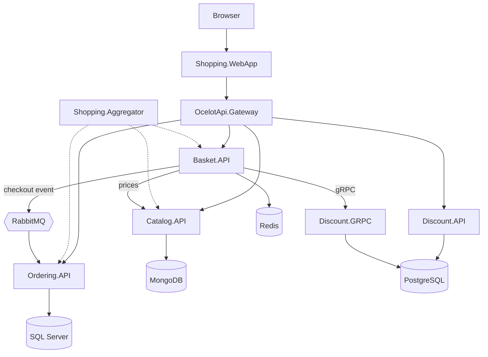

# Dotnet Microservices Shop

[](https://github.com/tanishkamali14/Microservices-App-dotnet-/actions/workflows/ci.yml)

An e-commerce backend built with **ASP.NET Core microservices**: separate services and databases for the catalog, baskets, discounts and orders, an API gateway, and event-driven checkout.

It started from the [aspnetrun microservices course](#credits) and has been extended with the fixes and features listed under [Changes on top of the course code](#changes-on-top-of-the-course-code).

---

## 🚀 Tech Stack
ASP.NET Core (.NET 10) • Web APIs • gRPC • RabbitMQ (MassTransit) • Ocelot API Gateway  
Docker • SQL Server • PostgreSQL • MongoDB • Redis • Entity Framework Core • Dapper  
OpenTelemetry • Polly • xUnit • GitHub Actions

---

## 🏗️ Architecture



- **Independent microservices** (Catalog, Basket, Discount, Ordering), each with its own database
- **API Gateway (Ocelot)** in front of the services, plus an aggregator that combines their responses
- **Synchronous calls over gRPC** (Basket → Discount) and **asynchronous messaging over RabbitMQ** (checkout → Ordering)
- **Clean Architecture and CQRS** in the Ordering service (MediatR, FluentValidation, EF Core)

---

## 🛠️ Changes on top of the course code
- **Upgraded** every service from .NET 6/7 (out of support) to **.NET 10 LTS**, with central package management, and replaced AutoMapper (CVE-2026-32933) with explicit mappings
- **Fixed** the Docker build paths, gateway routes, the web app's cart and checkout flow, catalog seeding and email settings binding
- **Price tampering and discount stacking:** baskets are now priced from the catalog on the server, so the client can't set prices and a discount can't be applied twice
- **Safe database startup:** the Discount service no longer drops its table on every start; migrations are idempotent and retried with backoff instead of a recursive `Thread.Sleep`
- **No duplicate orders:** checkout uses MassTransit's transactional inbox/outbox and an idempotency key, so a retried checkout can't create a second order
- **Resilience:** retries, timeouts and circuit breakers on HTTP and gRPC calls between services
- **Observability:** `/health/live` and `/health/ready` on every service, OpenTelemetry logs, traces and metrics, and Docker healthchecks so services wait for their databases
- **Secrets:** passwords come from a git-ignored `.env` file instead of the repository; removed Portainer, which had root-level access to the Docker host
- **Tests and CI:** xUnit tests for pricing, ordering and health endpoints, run by GitHub Actions on pull requests and pushes to `main`, together with a Docker image build

---

## ▶️ Run Locally
Requires Docker (and the .NET 10 SDK for running tests or services outside Docker). Create your `.env` from the template, change the passwords, then start everything:

```bash
cp .env.example .env
docker compose up --build
```

| What | URL |
|---|---|
| Shop (web app) | http://localhost:8006 |
| API gateway | http://localhost:8010 |
| Catalog, Basket, Discount, Ordering APIs (Swagger UI at `/swagger`) | ports 8000, 8001, 8002, 8004 |
| Shopping aggregator | http://localhost:8005 |
| Aspire dashboard (logs, traces, metrics) | http://localhost:18888 |
| RabbitMQ management (user and password from `.env`) | http://localhost:15672 |
| pgAdmin (`admin@aspnetrun.com`, password from `.env`) | http://localhost:5050 |

Every service also answers `GET /health/live` and `GET /health/ready`.

> If you ran an older version of the stack, run `docker compose down -v` once so the databases are recreated with the passwords from `.env`.

### Running a service outside Docker
Start the infrastructure with `docker compose up -d catalogdb basketdb discountdb orderdb rabbitmq`, then give the services the passwords from your `.env` through [user secrets](https://learn.microsoft.com/aspnet/core/security/app-secrets) (once per machine):

```bash
dotnet user-secrets set "DatabaseSettings:ConnectionString" "Server=localhost;Port=5432;Database=DiscountDb;User Id=admin;Password=<POSTGRES_PASSWORD>" --project src/Discount.API
dotnet user-secrets set "DatabaseSettings:ConnectionString" "Server=localhost;Port=5432;Database=DiscountDb;User Id=admin;Password=<POSTGRES_PASSWORD>" --project src/Discount.GRPC
dotnet user-secrets set "ConnectionStrings:OrderingConnectionString" "Server=localhost;Database=OrderDb;User Id=sa;Password=<MSSQL_SA_PASSWORD>;TrustServerCertificate=True" --project src/Ordering.API
dotnet user-secrets set "EventBusSettings:HostAddress" "amqp://<RABBITMQ_USER>:<RABBITMQ_PASSWORD>@localhost:5672" --project src/Ordering.API
dotnet user-secrets set "EventBusSettings:HostAddress" "amqp://<RABBITMQ_USER>:<RABBITMQ_PASSWORD>@localhost:5672" --project src/Basket.API

dotnet run --project src/Catalog.API   # and likewise for the other services
```

---

## ✅ Tests
```bash
dotnet test
```

---

## Credits
- Based on the earlier, Ocelot-based version of the **aspnetrun** course *Microservices Architecture and Implementation on .NET* by Mehmet Ozkaya ([reference code](https://github.com/aspnetrun/run-aspnetcore-microservices), MIT licensed; see [LICENSE](LICENSE)).
- Storefront theme: [Bootstrap e-commerce theme by T-PHP](https://t-php.fr/43-theme-ecommerce-bootstrap-4.html).
