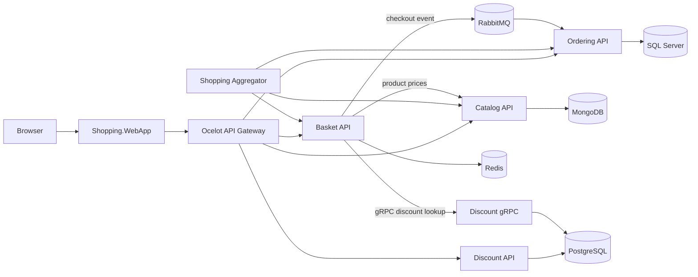

# Microservices Shop

A sample online shop built with ASP.NET Core microservices. The storefront talks to an API gateway and supporting services for catalog, basket, discounts, and orders. Docker Compose runs the application and its local infrastructure together.

> **Status:** learning and portfolio project. It is not ready for real customers or payment data; see [Security notes](#security-notes).

[](https://github.com/tanishkamali14/Microservices-App-dotnet-/actions/workflows/ci.yml)

## Contents

- [What’s included](#whats-included)
- [Architecture](#architecture)
- [Run locally](#run-locally)
- [Service URLs](#service-urls)
- [Build and test](#build-and-test)
- [Configuration](#configuration)
- [Deployment](#deployment)
- [Security notes](#security-notes)
- [Credits and license](#credits-and-license)

## What’s included

- **Catalog**: product data stored in MongoDB.
- **Basket**: Redis-backed baskets, server-side product pricing, and discount lookup.
- **Discount**: a REST API and a gRPC service backed by PostgreSQL.
- **Ordering**: order processing with SQL Server, CQRS, MediatR, and Entity Framework Core.
- **Messaging**: RabbitMQ and MassTransit publish checkout events to Ordering.
- **Storefront and APIs**: an ASP.NET Core web app, an Ocelot API gateway, and a response aggregator.
- **Operations**: health checks, OpenTelemetry, an Aspire dashboard, Docker health checks, and GitHub Actions CI.

The solution targets **.NET 10**. Package versions are managed centrally in `Directory.Packages.props`.

## Architecture



Checkout messages use an inbox/outbox and an idempotency key to guard against duplicate order creation when messages are redelivered. Service-to-service HTTP and gRPC calls use resilience policies. Readiness checks report whether each service's own dependencies are available.

## Run locally

### Requirements

- Git
- Docker Desktop with Docker Compose
- .NET 10 SDK, if you want to build or run tests outside containers

### Start the stack

From the repository root, create a local environment file from the template and replace the example passwords with your own development-only values:

**PowerShell**

```powershell
Copy-Item .env.example .env
notepad .env
```

**macOS/Linux**

```bash
cp .env.example .env
${EDITOR:-nano} .env
```

Start all services in the background:

```bash
docker compose up --build -d
docker compose ps
```

To follow the logs, run `docker compose logs -f`. Press **Ctrl+C** to stop following logs; the containers keep running. Stop the stack with:

```bash
docker compose down
```

This keeps database volumes. To remove the containers **and delete local database data**, use `docker compose down -v`.

## Service URLs

| Service | Local URL | Notes |
|---|---|---|
| Shop | <http://localhost:8006> | Storefront |
| API Gateway | <http://localhost:8010> | Public entry point for service APIs |
| Catalog API | <http://localhost:8000/swagger> | Swagger UI |
| Basket API | <http://localhost:8001/swagger> | Swagger UI |
| Discount REST API | <http://localhost:8002/swagger> | Swagger UI |
| Discount gRPC | <http://localhost:8003> | gRPC endpoint |
| Ordering API | <http://localhost:8004/swagger> | Swagger UI |
| Shopping Aggregator | <http://localhost:8005> | Aggregated API |
| Aspire Dashboard | <http://localhost:18888> | Local logs, traces, and metrics |
| RabbitMQ Management | <http://localhost:15672> | Credentials are in `.env` |
| pgAdmin | <http://localhost:5050> | Password is in `.env` |

HTTP services expose `GET /health/live` and `GET /health/ready`. The gateway health endpoint is available at <http://localhost:8010/health/ready>.

## Build and test

Run from the repository root with the .NET 10 SDK:

```bash
dotnet restore MicroservicesShop.sln
dotnet build MicroservicesShop.sln --no-restore
dotnet test MicroservicesShop.sln --no-build
```

The tests cover basket pricing, catalog behavior, ordering rules, and health endpoints. GitHub Actions also builds and tests the solution and builds the Docker images.

## Configuration

- `.env.example` documents the values Docker Compose needs. Keep your actual `.env` file local; it is ignored by Git.
- Docker Compose is the documented way to run the full application locally. The .NET SDK is needed to build and test the solution on the host.
- Do not put production credentials in `appsettings.json`, source control, or a Docker image. Use your hosting provider's secret manager for a deployed environment.

## Deployment

GitHub hosts the source code and runs CI; it does not run this complete application. `docker-compose.yml` is intended for local development and is not a production deployment by itself. A production host must support the .NET services and long-running message processing, and provide durable, secured databases, cache, and message broker services.

Vercel does not deploy this Compose stack as-is. Hosting there would require translating the HTTP services to Vercel's service configuration and moving the stateful databases, cache, and broker to external managed services. For a first deployment, use a platform designed to run Docker Compose or long-running containers, and keep the services private behind a secured public entry point.

Before making the app public, address the limitations below and configure HTTPS, authentication, secret storage, backups, and production network access controls.

## Security notes

- The sample has **no user authentication or authorization**. The demo identity is not suitable for a public shop.
- The course application stores card numbers and CVV values with orders. **Never enter real payment details.** Remove this behavior or integrate a compliant payment provider before any real use.
- Local `.env` values are for development only. Passwords that were committed in the original repository may remain in Git history; replacing them in the current files does not erase that history.
- The Aspire dashboard is configured for unauthenticated access on loopback for local development. Do not expose it publicly.

## Credits and license

This project builds on the earlier Ocelot-based version of Mehmet Ozkaya's **aspnetrun Microservices Architecture and Implementation on .NET** course ([reference repository](https://github.com/aspnetrun/run-aspnetcore-microservices)). The original MIT license notice is retained in [LICENSE](LICENSE).

The storefront uses the [T-PHP Bootstrap e-commerce theme](https://t-php.fr/43-theme-ecommerce-bootstrap-4.html).
